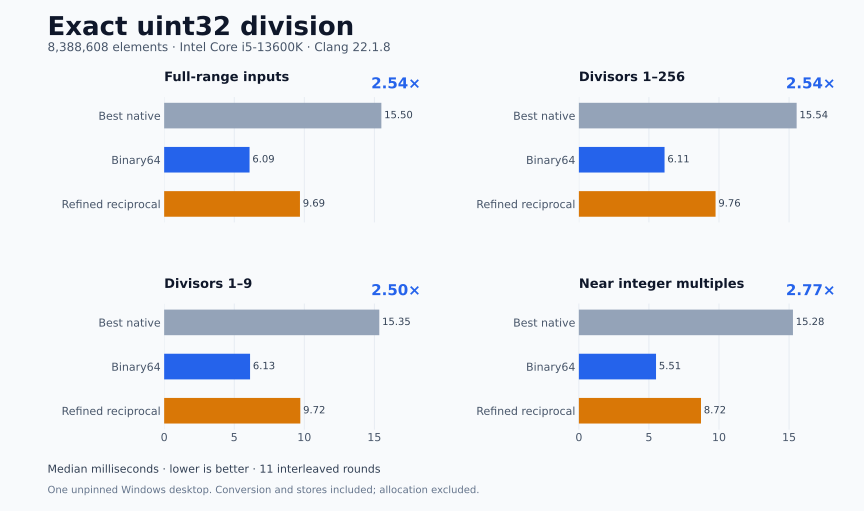

# CPU/GPU Math Lab

**Small experiments in faster arithmetic on existing hardware.**

[](https://github.com/Bender1011001/cpu-gpu-math-lab/actions/workflows/ci.yml)
[](LICENSE)


Pick an idea. Build a short experiment. Check the answer. Challenge the baseline. Keep the evidence.

This repository publishes reproducible numerical experiments, including useful negative results. The first release studies **exact unsigned 32-bit integer division through binary64 floating-point arithmetic**. CPU and GPU research is ongoing; the code in this release targets CPUs.

## First result: exact division, faster on the tested CPU

For nonzero `d`, ordinary IEEE binary64 arithmetic gives the exact integer quotient:

```cpp
uint32_t q = static_cast<uint32_t>(static_cast<double>(n) / static_cast<double>(d));
```

This lets a compiler use SIMD floating-point division for a batch of variable divisors. On the tested **Intel Core i5-13600K with Clang 22.1.8**, the straightforward loop was **2.50–2.77× faster** than the fastest of three native integer-division loops on the four large confirmation workloads. A reciprocal estimate with two Newton refinements was also tested and lost to direct binary64 division.



| 8,388,608 quotients | Fastest native loop | Binary64 loop | Speedup |
|---|---:|---:|---:|
| Full-range inputs | 15.503 ms | 6.095 ms | 2.54× |
| Divisors 1–256 | 15.543 ms | 6.115 ms | 2.54× |
| Divisors 1–9 | 15.354 ms | 6.131 ms | 2.50× |
| Near integer multiples | 15.279 ms | 5.506 ms | 2.77× |

These are medians from 11 interleaved rounds on one unpinned Windows desktop. Both input conversions and output stores are included; allocation and compilation are excluded. An independent input seed and seven timing rounds are also provided. This is a batch-kernel result; application performance and other CPUs may differ.

The method is established: see [Daniel Lemire's 2017 article](https://lemire.me/blog/2017/11/16/fast-exact-integer-divisions-using-floating-point-operations/). The contribution here is an inspectable experiment with stronger comparisons, correctness checks, and raw measurements. [Why it is exact →](docs/exact-division.md)

## Run it

Requires a C++17 compiler and CMake 3.20+. The C++ build has no third-party library dependencies.

```sh
git clone https://github.com/Bender1011001/cpu-gpu-math-lab.git
cd cpu-gpu-math-lab
cmake -S . -B build -DCMAKE_BUILD_TYPE=Release -DMATHLAB_NATIVE=ON
cmake --build build --config Release
ctest --test-dir build -C Release --output-on-failure
```

Then run the benchmark:

```sh
./build/mathlab_bench --output results.json --seed 20261136 --rounds 11 --cpu-label "your CPU"
python tools/summarize.py results.json
```

With Visual Studio's Windows generator, use `build\Release\mathlab_bench.exe`; with Ninja on Windows, use `build\mathlab_bench.exe`.

`MATHLAB_NATIVE=ON` tunes for your local machine. Such binaries may not run on another CPU. Leave it off for the default portable build. The AVX2/FMA comparison kernels are included when the compiler exposes both instruction sets; the benchmark records their availability. MSVC builds may omit those optional kernels.

## What is checked

- Exact integer reference comparisons on random inputs, powers of two and neighbors, quotient boundaries, small divisors, and scalar tails.
- **25,224,720 output comparisons** in the six-method local correctness test, plus **226,590,720** per benchmark run.
- Three native baselines: ordinary `/`, an unrolled loop, and an `n < d` shortcut.
- Direct binary64 division, an optional explicit AVX2 conversion variant, and an optional reciprocal-refinement challenger.
- All 12 benchmark cases, every individual timing sample, and fresh-seed confirmation results.

The full-domain proof applies to the direct binary64 formulation under its stated assumptions. Tests alone do not prove the reciprocal challenger correct for every input. Divisor zero, overlapping buffers, altered floating-point semantics, and equivalence of floating-point exception flags are outside the contract. Constant or repeatedly reused divisors have other strong approaches, such as [libdivide](https://libdivide.com/).

## Explore the evidence

| Resource | Contents |
|---|---|
| [Exactness and assumptions](docs/exact-division.md) | Short proof and implementation contract |
| [Methodology](docs/methodology.md) | Workloads, timing procedure, environment, limitations |
| [Results](results/README.md) | Raw JSON, source hashes, and validation record |
| [Experiment ledger](docs/experiments.md) | What survived and what did not |
| [Contributing](CONTRIBUTING.md) | Reproduce on another CPU or propose a bounded experiment |

New ideas start with a declared domain, accuracy requirement, competitive baseline, and decision rule. Initial experiments aim to take under ten minutes; promising findings receive deeper validation. A failed idea is a useful result when its failure is documented.

## Share a reproduction

Run the test and benchmark, then [open a reproduction report](https://github.com/Bender1011001/cpu-gpu-math-lab/issues/new?template=reproduction.yml) with your CPU, compiler, flags, and raw JSON. Cross-machine results and stronger baselines are especially useful.

Released under the [MIT license](LICENSE).
